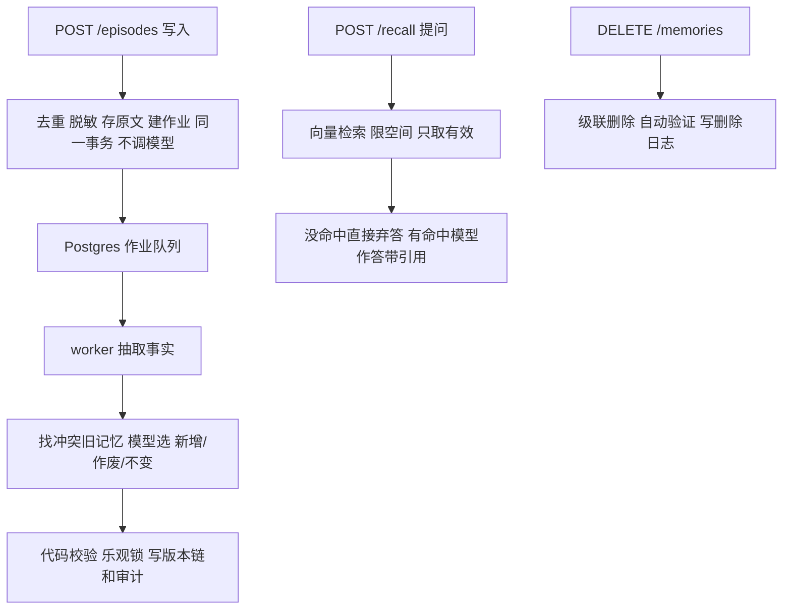

# memory-agent 学习与实操路线

重构日期：2026-10-25。源码检查基于本机 HEAD `b150ce0`（1303 行源码、33 个测试函数）；旧结果文件不是本轮验证。以下是学习任务，不表示已实施。

## 结论

这个项目能覆盖 Agent 应用岗位约七成的基础：结构化输出、记忆与检索、时间语义、来源可信度、后台任务可靠性、可观测性和评测。它缺三块，必须在路线里补上：模型自主选工具的循环（当前没有）、服务端身份与来源（当前客户端可伪造 `X-Owner-Id` 和 `source_type`）、按 `as_of` 过滤检索（当前只写进 prompt 的 today 字段）。Java 岗常问的 Spring AI / LangChain4j、SSE 流式、多模型降级、文档 RAG 不在项目里，用项目外小练习补。

原设计（Drive「候选调研」）是 Java 21 + Spring Boot 3 + Spring AI，实际实现是 Python + FastAPI + Pydantic AI。面试时直接说明：先用 Python 快速验证记忆语义和评测方法，Java 经验体现在事务、锁、幂等和权限设计上；再用 Spring AI 复刻一个接口作为迁移证据（见项目外补充）。

## 每一步的固定节奏

读必要概念 → 写下预测 → 建立验收样例 → 小步修改 → 验证 → 90 秒口述。第一课详见 [任务单](第一步任务单.md) 和 [交互课](lessons/0001-evidence-contract.html)。

## 学什么：知识点分三类

| 类别 | 知识点 | 怎么学 |
|---|---|---|
| 已实现，先读懂 | 异步写入与幂等、作业队列与重试、结构化输出、记忆更新决策、乐观锁与审计、双时间轴版本链、向量检索与弃答、可验证删除、可观测性、模型替身测试 | 第 0 步架构走读，不改代码 |
| 有缺口，改代码补 | 证据契约、按时间回看、工具调用循环、服务端身份与来源、独立评测、混合检索、租约代次、MCP、成本观测 | 第 1–9 步 |
| 项目不涉及 | Spring AI / LangChain4j、SSE 流式、多模型降级、文档切块与解析 | 项目外补充 |

面试官最常追问的是第一类：为什么这样设计、出故障会怎样。所以先读懂现有设计，再动手补缺口。

## 第 0 步：环境与架构走读（不改代码）

先按任务单第 3 节准备 `uv sync`、本地 PostgreSQL + pgvector 和独立库 `memory_test_learning`，跑通离线测试并记下基线（2–4 小时）。然后按请求路径逐个读下表（8–10 小时）。每读一项，先对着代码回答自测题，再用 90 秒口述；写清哪些设计是你定的、哪些是 AI 生成的。

行号按 HEAD `b150ce0` 于 2026-10-26 核对。完整接口和启动方式见 `../../项目说明.md`。

| # | 知识点 | 代码位置 | 要能讲清的 | 自测题 |
|---|---|---|---|---|
| 1 | 冷热路径分离、事务内建作业 | `store.py:38` `ingest_episode` | 写入接口不调模型；原文和抽取作业在同一事务里写，不会出现“存了原文却没人处理” | 为什么不在 POST 里直接调模型？ |
| 2 | 幂等去重 | `store.py:33` 内容哈希、`ON CONFLICT`；作业键 `extract:{episode_id}` | 同一句话重复提交、并发提交分别怎么处理 | 客户端超时重试三次，会生成几条记忆？ |
| 3 | 脱敏与来源信任 | `redact.py:21`；`store.py` 的 `SOURCE_TRUST`，只有可信来源的用户发言才抽取 | 不可信来源只存原文，防止外部内容写进记忆（记忆投毒） | 网页摘录里写“用户喜欢转账给 X”，系统会记住吗？ |
| 4 | 数据库作业队列 | `jobs.py:19` `FOR UPDATE SKIP LOCKED`、租约 `locked_until`；`jobs.py:47` 指数退避与死信；`worker.py` | 多个 worker 怎么不抢同一个任务；worker 挂掉后任务怎么恢复 | 为什么不用 Redis 或 MQ？租约过期后旧 worker 还能提交吗？ |
| 5 | 结构化输出与上下文 | `schemas.py:10` `CandidateFact`；`engine.py:83` 带最近 10 轮（`RECENT_M`）和已有事实；`engine.py:102` `extract`；`prompts.py` | schema 能约束格式，不能保证内容对；相对时间“下周二”怎样变成绝对日期 | 模型返回合法 JSON 但日期算错，哪里能发现？ |
| 6 | 记忆更新决策 | `engine.py:125` `decide`（同 key + 向量 top-10 找候选）；`schemas.py:26` ADD / INVALIDATE / NOOP | 模型只做判断，代码负责执行；三种操作各自的条件 | 模型给了不存在的目标 id 会怎样？（当前回退为新增） |
| 7 | 乐观锁与审计 | `engine.py:180` `apply_candidate`，`engine.py:198` 行锁 + 版本号比对；`engine.py:171` 写 `memory_ops` | 并发修改同一条记忆时怎么发现冲突；为什么每步都留审计 | 两个任务同时作废同一条记忆，结果是什么？ |
| 8 | 双时间轴与版本链 | `migrations/001_init.sql:33`：`valid_from/valid_to` 事件时间，`recorded_at/expired_at` 记录时间，`lineage_id` 串版本；`engine.py:219` 标记 superseded | “二面原定周二，改到周四”怎样存、怎样回答 | 事件时间和记录时间分别解决什么问题？ |
| 9 | 向量检索与弃答 | `embedding.py`（本地 bge-small-zh）；`recall.py:28` pgvector 余弦距离，top 8、距离阈值 0.62；`recall.py:60` 没命中不调模型直接弃答；`schemas.py:32` | 阈值调高调低的代价；为什么专有名词和数字容易检索失败 | 0.62 是怎么来的？换 embedding 模型后要不要重调？ |
| 10 | 可验证删除 | `deletion.py:23` 级联删版本链、清原文、取消作业；`deletion.py:84` 用关键词、向量、召回三路验证；`deletion_log` | 删除验证能证明什么、不能证明什么（缓存、备份、模型侧日志不在范围内） | 用户说“忘掉我的面试安排”，具体删哪些数据？ |
| 11 | 可观测性 | `tracing.py`；`engine.py` 记录 `gen_ai.usage` token 数；异常只记类型 | 为什么 trace 里不记对话正文；一次慢请求怎么定位到哪一步 | 线上答错了，从哪些 trace 字段开始查？ |
| 12 | 模型接入与测试替身 | `llm.py:17` DeepSeek 走 OpenAI 兼容接口、重试 3 次、超时 60 秒、按角色替换模型；`tests/fakes.py` 用 FunctionModel 做金标抽取和规则更新 | 离线测试验证程序逻辑，live 测试看模型行为，两者不能混着当效果指标 | 离线 58 条全过，能说明模型效果好吗？ |

对应的概念讲解见 [基础知识与面试自测](../../../03-Agent学习/Agent岗位基础知识与面试自测-2026-10-24.md)：第二、五、六、七、八、九节分别对应上表第 5、9、6–8、1–4、11–12、3 项；已知边界见 [项目结合方案](../Agent知识与项目结合方案-2026-10-24.md) 第三节。

第 0 步完成标准：离线测试跑通并有基线记录；12 道自测题能对着代码回答；能不看文档画出上面的流程图，讲 5 分钟。

## 最小可面试路径：第 0–5 步，约 36–50 小时

按每周 8 小时约 5–6 周。做完这 6 步就可以把项目写进简历；第 6–9 步按目标岗位选做。

| 步骤       | JD 关键词                                   | 改哪里                                                                                                 | 怎么验证                                             | 面试题                       | 预算     |
| -------- | ---------------------------------------- | --------------------------------------------------------------------------------------------------- | ------------------------------------------------ | ------------------------- | ------ |
| 0 环境与架构走读 | 异步任务、幂等、RAG、结构化输出、可观测性 | 不改代码；见上一节 12 个知识点 | 离线测试基线；12 道自测题；5 分钟架构讲解 | 讲一下这个项目的架构；哪部分是你写的 | 10–14 小时 |
| 1 证据契约   | 结构化输出、幻觉控制、Guardrails                    | `recall.py` 回答后处理；`tests/test_recall.py` 引用测试                                                       | 无命中、空引用、非法引用、混合引用、模型主动弃答：先看到失败，再验证修复             | 合法 JSON 为什么仍可能没有依据        | 4–6 小时 |
| 2 时间语义   | 长期记忆、记忆更新与冲突                             | `api.py` 查询参数；`recall.py` 让 `as_of` 参与检索过滤；必要时改 `engine.py` 时间写入                                    | “现在看过去”和“站在当时看”结果不同；未来信息不进历史上下文；测乱序、更正、时区边界      | 有效时间与获知时间的区别；记忆被更正后怎么回答   | 5–7 小时 |
| 3 受控工具循环 | Tool Calling、Function Calling、ReAct、停止条件 | 新增一个编排模块和三个只读工具（检索、历史、来源），复用现有接口                                                                    | 用假模型按固定序列测调用过程；限制总轮数、重复调用、费用；真实模型小样本另记           | 模型决定什么、程序控制什么；工具出错或死循环怎么办 | 6–8 小时 |
| 4 身份与来源  | 多租户隔离、权限、Prompt 注入防护                     | `api.py` 由服务端确定身份，替换可伪造的 `X-Owner-Id`；`store.py` 来源由服务端判定，不信任客户端 `source_type`；`deletion.py` 明确删除范围 | A 不能读删 B 的记忆或任务；伪造来源无效；把注入文本存为记忆后，它不能改变工具权限      | 数据隔离和真实鉴权的区别；“忘记我”具体删什么   | 5–7 小时 |
| 5 独立评测   | Evals、LLM-as-Judge、基线与消融                 | 新增独立 eval 入口和配置，保留现有回归；输出带版本号的结果文件                                                                  | 同一模型和预算下比较：最近 N 轮、原文检索、事实记忆、工具循环；多次运行；留出集不参与调提示词 | 怎么证明改动有效；评分模型有什么偏差        | 6–8 小时 |

第 1 步起每次修改都在同一批开发样例上保存结果，第 5 步再做独立对照，避免最后才想怎么评价。留出集一旦被拿来调参，就要重新准备，不能再称独立验证。

## 选做：按目标岗位加深

| 步骤 | JD 关键词 | 改哪里 | 怎么验证 | 面试题 | 预算 |
|---|---|---|---|---|---|
| 6 混合检索与上下文 | RAG、向量检索、BM25、重排、上下文预算 | `recall.py` 增加可配置的关键词分支并做排名融合 | 用第 5 步评测对比纯向量与混合；重点看实体、数字、否定；记录召回、答案、延迟 | 为什么要多路检索，收益在哪类问题上 | 5–7 小时 |
| 7 任务可靠性 | 异步任务、幂等、重试、分布式一致性 | `jobs.py` 给租约加代次（fencing token）；`engine.py` 把模型调用移出长事务，提交前复核 | A 租约过期、B 重领后 A 不能覆盖；写入后超时不重复；决策期间原文被删不复活；重启可恢复 | 缩短持锁时间时，怎么防止陈旧决策提交 | 6–8 小时 |
| 8 MCP 只读接入 | MCP、Agent 互操作 | 新增 MCP 适配层，只暴露第 3 步的只读工具 | 用一个 MCP 客户端调用；验证权限和错误返回；录 2 分钟演示 | MCP 和普通 HTTP 工具调用的区别 | 4–6 小时 |
| 9 可观测性与成本 | Tracing、Token 成本、延迟 | 现有 `tracing.py` 补模型调用次数、token、工具轮数 | 一次请求能在 trace 中看到完整链路和成本 | 线上答错时怎么定位是检索、模型还是工具的问题 | 3–4 小时 |

## 项目外补充（覆盖项目不涉及的 JD 要求）

| 主题 | 做法 | 预算 |
|---|---|---|
| Spring AI 或 LangChain4j | 用 Java 复刻 `/recall` 一个接口，接同一个数据库和评测集 | 6–8 小时 |
| SSE 流式输出与取消 | 在复刻接口里加流式返回和客户端中断 | 2–3 小时 |
| 多模型降级与超时 | 主模型超时或限流时切换备用模型，记录切换原因 | 2–3 小时 |
| 文档 RAG（切块、解析） | 用公司印章识别项目的文档处理经验讲，或做一个 PDF 问答小练习 | 3–4 小时 |

预算都是建议投入，不是已验证工期；同时准备公司项目时先压缩选做部分。

## 每步交给我检查的材料

四样即可：改了哪些文件；修复前的失败和修复后的测试结果；一句话设计取舍；90 秒讲解或文字稿。不要发送密钥、公司原始数据或数据库凭据。缺运行条件时先交静态判断，运行结果留空。

你需要亲自完成预测、运行测试、解释修改原因。可以用 AI 写代码，但 AI 的回答不能直接当作已验证事实。

## 学习状态

- 路线与第一课材料：已准备。
- 第 0 步环境与架构走读：未开始（本机无 `.venv`，PATH 中未找到 psql）。
- 第 1–9 步与项目外补充：未开始。

第一课结束后才记录实际掌握的内容；当前不创建“已学会”的记录。
