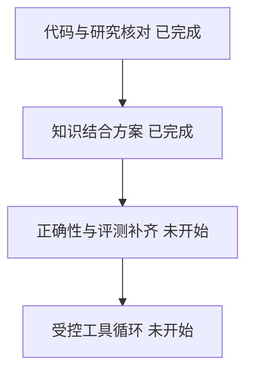
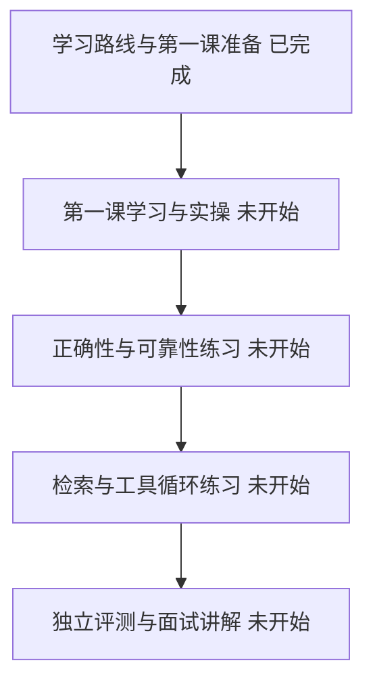
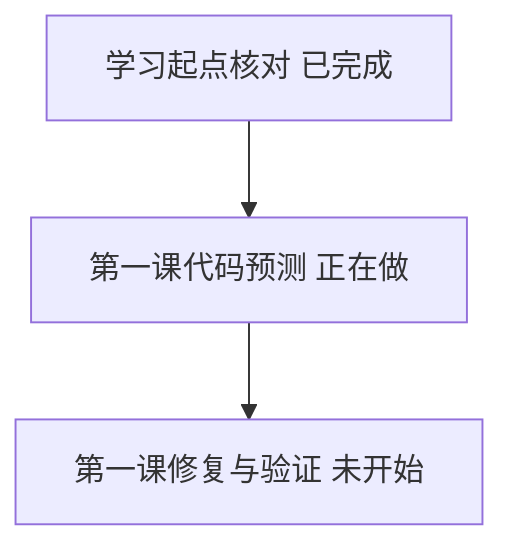
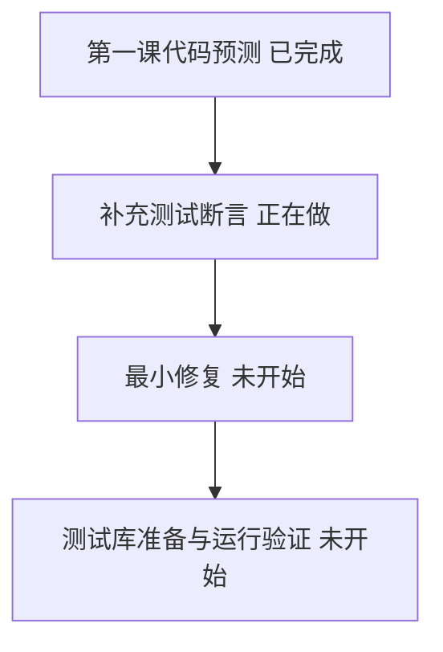
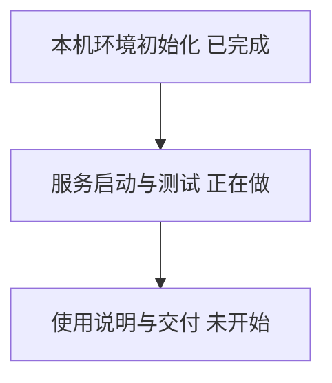
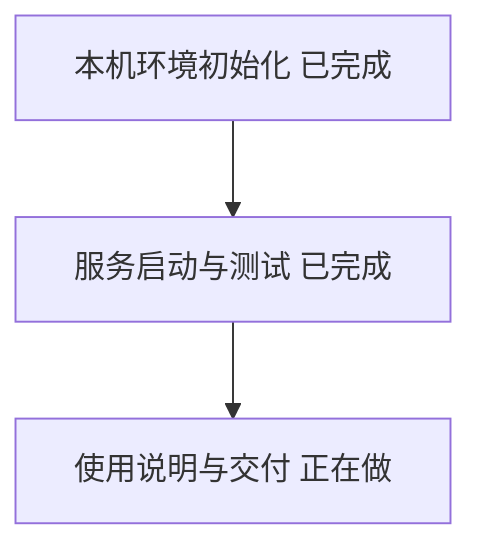
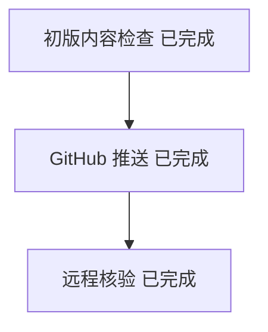

## 2026-10-24 — 基础知识与近期研究映射完成

阅读项目说明、核心代码、数据库定义、测试逻辑和已有结果，把模型调用、检索、记忆、任务恢复、评测与权限对应到具体模块。结合 Hindsight、MemFit、Graphiti 和 LongMemEval 两代基准，整理了可以逐步验证的增强方案，已保存为同目录的知识结合文档。

选择沿现有 Python 和 PostgreSQL 深化，因为已经有可追查的实现；没有建议整体重写 Java 或立即加入复杂多 Agent 和图数据库。最值得补的是时间查询、证据与权限契约、故障恢复，以及三个只读工具组成的有限决策循环。

静态检查发现 as_of 未进入检索时间过滤、引用 ID 清理后仍可能保留无引用回答等边界；现有 58 条离线和 20 条 live 通过来自 10 月 23 日历史报告，本次未复跑。新研究只用于设计参照，未复现论文效果，未改业务代码或运行服务。

下一步建议先固定独立评测样本和正确性契约，再按方案实施和比较。当前仅完成评估，不代表增强项已实现。

## 2026-10-25 — 学习路线与第一课任务准备完成

已按学习、修改、验证和面试讲解四个角度安排八步路线，第一课聚焦“无有效引用却继续返回确定答案”的真实代码边界。提供任务单、可阅读练习页、速查页，以及具体文件入口、五种验收情况和测试顺序。

选择先练一个小问题，是因为结构化输出、业务判断与测试证据能在一个场景里学清楚，再进入时间、权限、恢复和工具循环。没有一次性替用户完成所有业务修改，练习留给用户预测、实践和解释，也没有把阅读材料算成已经掌握。

当前 HEAD 为 b150ce0；静态核对确认旧测试只检查引用列表，不检查弃答与原答案。学习页本地链接、任务单 Python 片段语法及文档结构检查通过；尚未在浏览器中验收排版。本目录没有 .venv，当前 PATH 未找到 PostgreSQL 客户端，未运行会清空测试表的 pytest，也没有调用真实模型。环境准备与应用测试结果仍待完成。

下一步从第一课的代码预测与五条验收规则开始，独立测试库准备好后再补断言和最小修复。用户学习、代码修复和验证尚未完成。

## 2026-10-26 — 学习起点核对完成

已核对学习目标、当前回答代码和测试：第一课的问题仍在，代码会删掉无效引用，却可能保留原答案。沿用已有练习，是因为它能把后端校验经验直接接到模型输出上，无需另起课程。

本次只核对了源码，没有运行应用测试，也没有修改业务代码；用户掌握程度尚待代码预测反馈，不能将材料准备算成学习完成。下一步先做一道代码预测题，再按理解情况补讲和实操。

## 2026-10-26 — 第一课代码预测完成

用户读代码后，准确说出了问题：模型给出的引用编号全部无效时，代码只把引用清空，原答案“面试在周五”仍会返回，也还标记为“正常回答”（abstain=false，abstain 指“放弃回答”）。用户还指出，现有测试只检查引用为空，没有检查是否放弃回答，也没有检查原答案是否被换掉，所以测试能通过。

先预测再改代码，是为了确认用户读懂了问题，再动手修复，避免照着步骤机械操作。也考虑过直接修复，但那样难以确认用户理解了问题，所以没有采用。

这一步只读了代码，没有运行测试。本机还没有项目环境 .venv、PostgreSQL 或 Docker，所以“现有测试能通过、新断言会失败”目前都只是静态推断。下一步让用户先补测试断言，并为“模型根本不给引用”的情况新写一条测试，然后再准备测试库实际运行。

## 2026-10-26 — 本机环境初始化完成

已装好原生 ARM Python 3.12.13、锁定依赖、PostgreSQL 16.15 和 pgvector 0.8.7。运行库 memory_learning 与独立测试库 memory_test_learning 已建表；中文向量模型实际生成了 512 维向量。

默认 Python 经 Rosetta 运行，无法安装锁定的 onnxruntime，因此改用原生 ARM Python，不改依赖版本。旧脚本面向 Linux，本机 Homebrew 也经 Rosetta 运行，因此将数据库编译安装在项目 .local 目录，未修改系统服务。下载源码已核对 SHA256。移除当前进程的兜底 SOCKS 代理，保留 HTTP(S) 代理，解决模型下载缺少 socksio 的错误。

依赖和建表已验证，应用测试尚未执行。尚无 DeepSeek 密钥，真实模型流程待配置；Jaeger 界面本次不启用，测试仍可验证追踪记录。下一步启动 API 和后台进程，运行全部离线测试。

## 2026-10-26 — 服务启动与离线测试完成

API 与后台进程已启动。页面、接口文档、记忆列表及无记忆弃答均通过实际请求检查，测试账号连接运行库被拒绝。全部离线测试 58/58 通过，包含 38 条单元/集成和 20 条回归，耗时 2.53 秒。

采用固定模型替身检查程序行为，无需密钥并可稳定复现测试输入；这不证明真实模型质量。20 条真实模型测试未运行，依赖存在一条事件循环弃用警告。第一课的引用过滤问题未修改。下一步整理启动、测试和密钥配置说明。

## 2026-10-26 — 使用说明与交付完成

已保存 docs/local-setup.md，并在 README 加入本机入口。停止后重新启动成功，API、后台进程、数据库当前均在运行，健康检查成功。启动脚本语法与 Git 差异空白检查通过。

保留原 Linux 脚本，新增本机入口，避免改变旧环境用法。运行库和测试库分开，重启无需重新安装依赖。当前环境及 58 条离线测试已验证；真实问答仍缺 DeepSeek 密钥，Jaeger 界面未启用。尚未修改或验证第一课修复。下一步可回到第一课补断言、观察失败，再修复代码。

## 2026-10-27 — GitHub 初版准备完成

已检查当前文件和历史提交，密钥特征扫描仅命中脱敏测试中的模拟数据；本机数据库、模型缓存、虚拟环境和密钥文件均被忽略。本版包含已有代码、学习资料和本机启动入口，不修改业务逻辑。

保留已有 Git 历史以便追溯实现；使用当前账号 wanghao-SunSky，新建私有 memory-agent 仓库，初始默认分支采用 main。测试依据为 2026-10-26 的 58/58 离线通过记录，本次未复跑；脚本语法及差异空白检查通过，真实模型测试仍未验证。下一步创建仓库、推送并核对远程提交。

## 2026-10-27 — GitHub 初版发布完成

私有仓库 https://github.com/wanghao-SunSky/memory-agent 已创建，初版提交 49ac9a3 已推送 main；既有三个提交完整保留。GitHub 已确认私有设置和默认分支 main，本地跟踪 origin/main 且无未提交文件。

采用私有仓库保存当前学习基线，未改变业务逻辑，也未重跑测试；验证范围仍为昨日离线 58/58，真实模型测试尚未运行。本条发布记录随随后文档提交同步，接下来可从该基线继续第一课。

